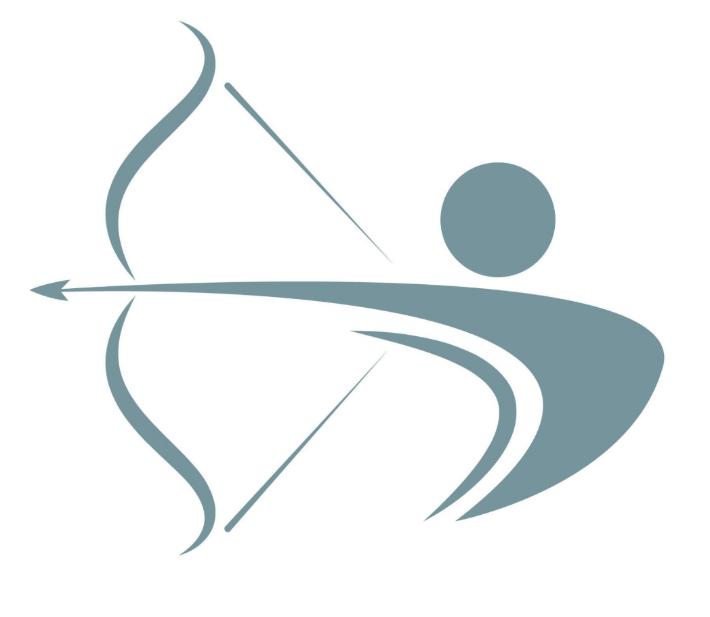

<p align="center">
  
</p>

<h1 align="center">FLIGHT CLUB — ARCHERY RANGE</h1>

<p align="center">
  <strong>A 3D WebGL Ballistic Archery Simulator &bull; Built with Three.js & Vanilla Web Standards</strong><br>
  <em>"A quiet mind. A steady hand. One perfect shot."</em>
</p>

<p align="center">
  
  
  
  
  
  
</p>

<p align="center">
  <a href="#-quick-start">Quick Start</a> &bull;
  <a href="#-key-features">Key Features</a> &bull;
  <a href="#-controls--how-to-play">Controls</a> &bull;
  <a href="#-ballistics--aerodynamics-engine">Ballistics Engine</a> &bull;
  <a href="#-target-geometry--scoring">Scoring System</a> &bull;
  <a href="#-project-structure">Project Structure</a> &bull;
  <a href="#-pro-tips-for-archers">Pro Tips</a>
</p>

---

## 🌲 Overview

**Flight Club** brings the discipline, patience, and ballistics of target archery into the browser. Set against a serene procedural pinewood forest, the simulator combines real-world aerodynamics, sub-stepped trajectory integration, animated limb draw tension, variable crosswinds, and cinematic camera tracking.

Built with **zero external build pipelines**, **zero node_modules dependencies**, and **100% procedural Web Audio**, Flight Club boots instantly with zero setup.

---

## ✨ Key Features

### 🏹 True Recurve Bow Mechanics & Sway
- **Smooth Draw Zoom**: Holding draw smoothly zooms sight magnification (up to $1.8\times$) toward the target line.
- **Physiological Aim Sway**: Holding full draw for too long induces realistic muscular tremors and breathing sway ($\sin / \cos$ harmonic oscillations) that challenge your marksmanship.
- **Minimum Draw Check**: Distance-dependent minimum draw thresholds (from 20% at 10m up to 100% at 90m). An underpowered release safely holds the arrow and prompts for a full draw.

### 💨 Dynamic Crosswinds & Drifting Leaves
- **Variable Lateral Crosswinds**: Wind speed (0.5 to 5.5 m/s) dynamically randomizes before every shot and alternates direction (left and right) so each six-arrow round challenges both sides evenly.
- **Visual Leaf Physics**: 3D animated forest leaves drift across the field in real-time in the exact direction and speed of the active wind, giving intuitive visual feedback before you let fly.
- **Post-Shot Drift Telemetry**: Accurate HUD readouts report sideways displacement compared against identical shots in still air.

### 📱 Precision Mobile Aiming (Virtual Trackpad)
- **Relative Drag Input (`aim-input.js`)**: On touch screens, touch anywhere on the canvas to draw without moving the crosshair, then slide your finger like a precision trackpad.
- **Unobstructed View**: Your finger never blocks the target or reticle, allowing pinpoint sight alignment on phones and tablets.

### 🎬 Broadcast Cinematic Camera Director
- **Chase Camera**: Seamlessly flies behind the arrow shaft through the flight path.
- **Dynamic Bullet-Time**: Triggers slow-motion pacing when an arrow is tracking directly toward the golden bullseye.
- **Orbiting Impact Cam**: Switches to an orbiting close-up showing arrow flex, shaft vibration, and wood splinter particles upon target impact.

### 🔊 100% Procedural Web Audio Engine
- **Zero Audio Files Required**: No MP3 or WAV downloads! Every sound effect is synthesized dynamically in real-time via the Web Audio API:
  - *Limb Tension*: Organic wooden stress creak during draw.
  - *String Release*: Crisp string snap transient with resonant decay.
  - *Flight Swish*: Aerodynamic low-pass filtered air flutter.
  - *Target Strike*: Satisfying wooden thud and softer ground-dirt miss impact.

---

## 🎯 Controls & How to Play

| Action | Desktop (Mouse) | Mobile / Touch | Keyboard |
| :--- | :--- | :--- | :--- |
| **Draw Bow** | Press & Hold Left Mouse Button | Touch & Hold anywhere on canvas | Hold `Space` |
| **Aim** | Move cursor to position reticle | Slide finger to adjust aim (relative drag) | Pre-aimed reticle |
| **Release / Shoot** | Release Left Mouse Button | Lift finger from screen | Release `Space` |
| **Cancel Draw** | Move pointer off-screen | Gesture cancel / multi-touch | Window blur |
| **Toggle Flight Preview** | UI Checkbox | Tap Preview toggle | `T` |
| **New Round / Reset** | Click "Reset" button | Tap "Reset" button | `R` |
| **Change Distance** | Click Distance buttons (10m–90m) | Tap Distance buttons | — |
| **Toggle Audio** | Click "Sound" button in header | Tap "Sound" button | — |

> [!TIP]
> **Reading the Wind:** Trajectory assist compensates for vertical gravitational drop in **still air only**; it never compensates for wind.
> - **Wind blowing Right ($\rightarrow$)**: Aim into the wind by shifting your reticle **LEFT**.
> - **Wind blowing Left ($\leftarrow$)**: Aim into the wind by shifting your reticle **RIGHT**.
> - Watch the drifting autumn leaves to gauge wind strength and direction!

---

## 📐 Ballistics & Aerodynamics Engine

Flight trajectories are calculated via high-frequency sub-stepped numerical integration:

```text
                  ┌────────────────────────┐
                  │      Bow Release       │
                  │ Launch Velocity Vector │
                  └───────────┬────────────┘
                              │
                              ▼
                  ┌────────────────────────┐
                  │ 240 Hz Integrator Step │
                  │  • Gravity: -9.81 m/s² │
                  │  • Quadratic Air Drag  │
                  │  • Crosswind Force     │
                  └───────────┬────────────┘
                              │
                              ▼
                  ┌────────────────────────┐
                  │ Swept-Plane Collision  │
                  │   Shaft-Radius Check   │
                  └────────────────────────┘
```

### Physical Parameters
- **Prototype Launch Force**: $5.1\,\text{N}$ effective prototype constant
- **Arrow Mass**: $25\,\text{g}$ ($0.025\,\text{kg}$)
- **Shaft Outer Radius**: $4\,\text{mm}$ ($0.004\,\text{m}$)
- **Air Density ($\rho$)**: $1.225\,\text{kg/m}^3$ (sea level)
- **Drag Coefficient ($C_d$)**: $1.1$ aerodynamic shaft profile
- **Cross-Sectional Area**: $0.00004\,\text{m}^2$

---

## 🏆 Target Geometry & Scoring

Target rings strictly adhere to official international target-archery concentric proportions:

<div align="center">

| Ring Zone | Diameter / Radius | Points | Accolade Label |
| :--- | :--- | :---: | :--- |
| **Inner X-Ring** | $r = 0.90\,\text{cm}$ | **10** (+10 bonus) | `PERFECT X` |
| **10-Ring (Bullseye)** | $r = 3.25\,\text{cm}$ | **10** (+5 bonus) | `BULLSEYE` |
| **Gold (9-Ring)** | $r = 6.50\,\text{cm}$ | **9** | `IN THE GOLD` |
| **Red (7–8 Rings)** | $r = 13.0–19.5\,\text{cm}$ | **7–8** | `ON THE BOARD` |
| **Blue (5–6 Rings)** | $r = 26.0–32.5\,\text{cm}$ | **5–6** | `ON THE BOARD` |
| **Black (3–4 Rings)** | $r = 39.0–45.5\,\text{cm}$ | **3–4** | `ON THE BOARD` |
| **White (1–2 Rings)** | $r = 52.0–65.0\,\text{cm}$ | **1–2** | `ON THE BOARD` |
| **Miss** | $r > 65.0\,\text{cm}$ | **0** | `JUST WIDE / OUT OF RANGE` |

</div>

> [!NOTE]
> **Line Cutters**: A true line-cutter rule evaluates the arrow's outer shaft radius ($4\,\text{mm}$). If any portion of the shaft intersects an inner ring's boundary, the higher point score is awarded.
>
> **Robin Hood**: Splitting or colliding with a previously embedded arrow shaft on the target triggers the rare `ROBIN HOOD` accolade!

---

## ⚡ Quick Start

No build setup, compilation, or package manager required. Run using any static web server:

### Python 3
```bash
python3 -m http.server 8080 --directory dist
```

### Node.js (`npx serve`)
```bash
npx serve dist -l 8080
```

### PHP
```bash
php -S localhost:8080 -t dist
```

Then visit **[http://localhost:8080](http://localhost:8080)** in your browser.

---

## 📁 Project Structure

```text
flight-club-archery/
├── README.md               # Visual overview & comprehensive documentation
├── LICENSE                 # MIT License
├── .gitignore              # Git ignore rules
└── dist/                   # Zero-build static web root
    ├── index.html          # Semantic HTML5 layout, HUD overlays & modal dialogs
    ├── style.css           # Clean typography, responsive grid & range aesthetic
    ├── game.js             # Core game state, round management, events & HUD loop
    ├── scene3d.js          # Three.js 3D scene, procedural lighting, bow & foliage
    ├── aim-input.js        # Mobile relative drag aim & pointer capture controller
    ├── audio.js            # 100% procedural Web Audio synthesizer engine
    ├── wind-leaves.js      # Wind particle physics & leaf drift simulation
    ├── target-config.js    # Shared target ring geometry constants
    ├── archer.png          # High-resolution brand emblem
    └── vendor/
        ├── three.module.js # Vendored Three.js r170 (ES Module)
        └── THREE-LICENSE.txt # MIT License for Three.js
```

---

## 🏹 Pro Tips for Archers

1. **Watch the Foliage**: Before drawing your bow, glance at the floating leaves in the 3D scene. Fast flutter means heavy crosswind ($4.0+\,\text{m/s}$).
2. **Don't Hold Draw Too Long**: Steady your aim quickly. Holding full tension for more than 3 seconds will cause your archer's muscles to fatigue, introducing aim tremor.
3. **Respect the Range**: At 70m and 90m distances, you must achieve 90%–100% draw power; short draws will fall short of the boss.
4. **Master the Alternating Gusts**: Wind alternates direction every shot across a six-arrow round. Develop the reflex to flip your wind compensation after each arrow!

---

## 📄 License

- **Source Code**: Released under the [MIT License](LICENSE).
- **Three.js**: Vendored under the [MIT License](dist/vendor/THREE-LICENSE.txt).
- **Audio & Assets**: 100% original procedural code and assets created for Flight Club.
